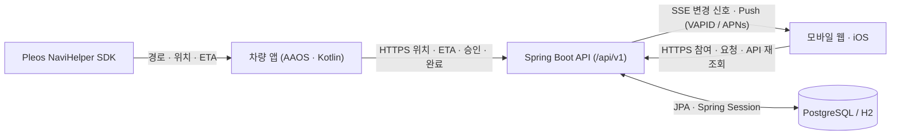

<div align="center">
  
  <h1>마중 백엔드 (Majung Backend)</h1>
  <p>차량 앱(AAOS)과 모바일 클라이언트(웹·iOS) 사이에서 운전자 계정, 차량 연결, 픽업 초대·요청, 장소 변경, 실시간 위치·ETA 공유를 관리하는 Spring Boot API 서버다.</p>
  <p>
    <a href="https://github.com/majung-team/majung">마중 프로젝트</a> ·
    <a href="https://github.com/majung-team/majung/wiki">Wiki</a> ·
    <a href="https://majung.cloud">모바일 웹</a> ·
    <a href="https://majung.cloud/api/swagger-ui/index.html">Swagger UI</a> ·
    <a href="https://majung.cloud/api/v1/health">API Health</a> ·
    <a href="https://github.com/majung-team/majung/blob/main/docs/development-status.md">개발 현황</a>
  </p>
</div>

> 서버는 내비게이션 경로나 교통 상황을 직접 계산하지 않는다. 경로와 예상 도착 시간(ETA)은 차량의 Pleos NaviHelper SDK가 제공하는 값을 수신해 유효성과 접근 권한을 검증한다.

---

## 1. 주요 기능

### 차량 등록 · 운전자 연결
- **QR 페어링**: 차량 QR 요청 → 카카오 로그인 운전자 확인 → 차량 최종 승인 및 접근 권한 발급·복구·철회
- **권한 분리**: 일반 최초 연결에 관리자 등록 코드 불필요(내부 시험 절차와 분리), 차량 소유권 인증이 아닌 서비스 접근 권한 설정

### 계정 · 사람 연결
- **인증·계정**: 카카오 OAuth2(웹·iOS PKCE `/api/v1/auth/ios/login`·`/exchange`), 닉네임·마중 ID·세션 관리, 회원 탈퇴(`DELETE /api/v1/accounts/me`)
- **지인 연결**: 사용자 검색 및 연결 승인·거절 지원, 사전에 연결되지 않은 운전자에게도 검색 후 픽업 요청 가능

### 픽업 초대 · 대기열
- **초대 참여**: 30분 만료 초대 토큰 발급, 참여 전 유효 여부·장소 확인(`invitation-preview`, 링크 미소진)
- **비로그인·대기열**: 회원가입·이름 입력 없는 게스트 참여, 대기 이탈(`POST /api/v1/pickups/{id}/leave`), 요청 대기열 SSE(`GET /api/v1/ride-requests/events`)
- **픽업 격리**: 차량당 진행 중 픽업 1건 유지, 권한 없는 다른 픽업의 위치·ETA 노출 차단

### 위치 · ETA · 소통
- **실시간 검증**: Pleos SDK 위치·ETA의 SDK/서버 시각·전송 순번·목적지 일치를 검증하고 종료 후 공유 차단
- **소통·알림**: 준비 상태·3종 퀵 메시지(`POST .../quick-message`, 스냅샷 `quickMessage`·`vehicleName` 반영·차량 TTS 낭독), Web Push(VAPID)·APNs 도착 임박 알림

### 장소 검색 · 변경 · 도착
- **장소 검색**: 한국 장소·주소 프록시(`GET /api/v1/places/search`)로 카카오 키워드·주소 병합 및 중복 제거(키 미설정 시 `{enabled:false}`)
- **장소 변경**: 탑승자의 장소 변경 제안 시 내비 SDK 경로 검증 및 운전자 확정 전까지 기존 장소 유지
- **도착·종료**: 반경 100m 자동 도착 또는 수동 도착/완료·취소·만료(ETA 0만으로 자동 완료 안 함, 운전자 확인 후 종료)

### 다중 픽업 계획
- **경로 최적화**: `/api/v1/pickup-plans` 경유지 추가·삭제(`stops`), TSP 순열 최단 경로 최적화(`optimize`, 5개 이하), 1회 확정(`confirm`)
- **진행·종료**: 확정 후 탑승자별 ETA 조회(`GET .../eta`), 경유지별 완료(`complete`), 계획 취소(`cancel`)

---

## 2. 시스템 구성 및 기술 스택



> SSE는 상태 변경 신호만 전달하며, 클라이언트는 신호 수신 또는 재연결 시 필요한 API를 다시 조회해 최신 상태를 맞춘다.

### 패키지 구조

```text
src/main/java/app/majung/server/
├── MajungServerApplication.java
└── pickup/
    ├── api/         # REST · SSE 엔드포인트 컨트롤러
    ├── service/     # 도메인 비즈니스 로직 · TSP 최적화 · 장소 검색
    ├── domain/      # JPA 엔티티
    ├── repository/  # Spring Data JPA 저장소
    ├── security/    # OAuth2 · 세션 쿠키 · 권한 검증 · Rate Limit
    ├── push/        # SSE 스트림 · Web Push(VAPID) · Apple APNs
    ├── job/         # 활성 슬롯 전용 픽업 만료 · 보존 정리 작업
    └── common/      # 예외 처리 · Swagger 설정 · 배포 정책

src/test/java/app/majung/server/pickup/
└── api · service · security · push · job · common   # 계층별 단위 · 통합 테스트
```

### 기술 스택

| 구분 | 구성 |
| --- | --- |
| **백엔드** | Java 17 컴파일(JDK 25 런타임) · Spring Boot 4.0.8 · Spring MVC · Spring Security OAuth2 Client · Spring Data JPA |
| **데이터 · 세션** | PostgreSQL(운영) · H2(로컬/테스트) · Spring Session JDBC(`SPRING_SESSION`) |
| **알림 · 문서** | Server-Sent Events(SSE) · Web Push(VAPID) · Apple APNs · springdoc OpenAPI (Swagger UI) |
| **인프라 · 배포** | Caddy(HTTPS Reverse Proxy) · GitHub Actions · GCP VM (단일 VM Blue-Green) |

---

## 3. API 기준 · 보안 및 검증 범위

- **접근 권한 분리**: 모든 엔드포인트는 `/api/v1/`를 사용하며 웹 로그인 세션, 차량 등록·접근 권한, 픽업 운전자 권한, 초대·탑승자 권한을 구분해 요청 대상과 현재 상태를 검증한다.
- **위치 최신성과 데이터 파기**: 차량 SDK 수신 시각, 서버 수신 시각, 전송 순번, 목적지·장소 버전을 함께 확인해 전송 시각만 갱신된 오래된 GPS를 최신값으로 취급하지 않으며, 완료·취소·만료 후에는 위치 접근을 차단한다([픽업 생명주기](docs/pickup-lifecycle.md)).

| 구분 | 범위 |
| --- | --- |
| **자동화 검증 범위** | 차량·운전자 계정 연결, 픽업 초대·참여·요청 대기열, 위치·ETA 유효성, 상태 전환·종료, Blue-Green 후보 서버·공유 세션·배포 실패 복구 경로 |
| **실환경 별도 확인** | 실제 휴대전화 간 전체 픽업 흐름, iPhone 등 실기기 푸시 배너 수신, LTE·Wi-Fi 네트워크 전환, 실차 SDK 장시간 연동 및 시동 OFF/ON 복구 |

> 코드 구현 및 자동화 테스트 통과를 실차·실기기 통합 검증 완료로 간주하지 않으며, 기능별 시험 근거는 [개발 현황](https://github.com/majung-team/majung/blob/main/docs/development-status.md)에서 확인한다.

---

## 4. 운영 환경 · Blue-Green 배포

운영 환경에서는 Caddy가 `https://majung.cloud` HTTPS 요청을 받아 `/api/`는 Spring Boot 서버로, 정적 파일은 웹으로 분기한다. `https://majung.cloud/api/v1/health` 응답의 `status`, `revision`(배포 커밋), `slot`(`standalone`·`blue`·`green`)으로 현재 상태를 확인한다.

- **전환 흐름**: 단일 GCP VM 내 `Blue(8081)`·`Green(8082)` 비활성 슬롯에 새 JAR 배포 → DB·세션·커밋 SHA·슬롯 점검 → Caddy 업스트림 전환 → 공개 HTTPS 확인 → 정기 작업(`job`) 슬롯 전환 → 이전 서버 안전 종료(실패 시 기존 슬롯으로 복구)
- **공유 세션 · 정기 작업**: 두 슬롯이 PostgreSQL `SPRING_SESSION`·`SPRING_SESSION_ATTRIBUTES`를 공유해 전환 중 로그인·CSRF 세션을 유지하며, 만료·데이터 정리 작업은 활성 슬롯에서만 실행
- **운영상 한계**: 단일 VM 내부 전환이므로 VM/PostgreSQL 이중화를 대체하지 않으며, 전환 중 끊긴 SSE는 클라이언트가 재접속 후 API 재조회 필요
- **DB 변경 주의**: 이전 JAR 롤백이 DB 스키마를 되돌리지 않으므로 컬럼 삭제·이름 변경 같은 비호환 변경은 앱 배포 전에 역호환성과 백업·권한을 별도 검토

상세 운영 절차: [Blue-Green 배포](docs/blue-green.md) · [GitHub Actions 배포](docs/github-actions.md) · [백업 복원·운영 점검](docs/operations-recovery.md) · [복구·ETA·권한 검증](docs/stability-verification.md)

---

## 5. 상세 문서 · 관련 저장소 · 개발 참여

| 분류 | 문서 |
| --- | --- |
| **계정 · 차량** | [차량 QR 최초 연결](docs/vehicle-enrollment.md) · [차량 계정 연결](docs/vehicle-account-link.md) · [내부 등록 및 권한 철회](docs/vehicle-registration.md) · [계정 및 사람 검색](docs/account-connections.md) |
| **픽업 · 공유** | [픽업 요청 및 대기열](docs/ride-requests.md) · [차량 위치 최신성](docs/vehicle-state.md) · [도착 임박 푸시](docs/arrival-push.md) · [장소 변경 제안](docs/place-proposal.md) · [픽업 생명주기](docs/pickup-lifecycle.md) |
| **운영 · 개발** | [GitHub Actions 배포](docs/github-actions.md) · [Blue-Green 배포](docs/blue-green.md) · [현재 개발 기준](docs/revised-plan.md) · [기여 가이드](CONTRIBUTING.md) |

| 저장소 | 역할 |
| --- | --- |
| [majung](https://github.com/majung-team/majung) | 전체 서비스 소개 · 설계 · 시연 |
| [majung-vehicle-app](https://github.com/majung-team/majung-vehicle-app) | AAOS 차량 앱 및 Pleos SDK 연동 |
| [majung-web](https://github.com/majung-team/majung-web) | 운전자 · 탑승자 모바일 웹 |
| [majung-ios](https://github.com/majung-team/majung-ios) | SwiftUI iOS 모바일 앱 |
| [majung-backend](https://github.com/majung-team/majung-backend) | Spring Boot API 및 운영 배포 |

기여 시 [기여 가이드](CONTRIBUTING.md)를 따르며, 로컬 커밋 메시지 검사 도구는 `npm ci`로 설치한다. 환경변수 템플릿은 [deploy/server.env.example](deploy/server.env.example)을 참고하고(운영 키·DB 비밀번호 저장소 작성 금지), 기능 변경 시 실제 실행한 테스트 결과와 남은 검증 항목을 PR에 기록한다.
