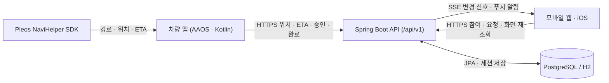

<div align="center">
  
  <h1>마중 백엔드 (Majung Backend)</h1>
  <p>차량 앱(AAOS)과 모바일 클라이언트(웹·iOS) 사이에서 운전자 계정, 차량 연결, 픽업 초대·요청, 장소 변경, 실시간 위치·ETA 공유를 관리하는 Spring Boot API 서버입니다.</p>
  <p>
    <a href="https://github.com/majung-team/majung">마중 프로젝트</a> ·
    <a href="https://github.com/majung-team/majung/wiki">Wiki</a> ·
    <a href="https://majung.cloud">모바일 웹</a> ·
    <a href="https://majung.cloud/api/swagger-ui/index.html">Swagger UI</a> ·
    <a href="https://majung.cloud/api/v1/health">API Health</a> ·
    <a href="https://github.com/majung-team/majung/blob/main/docs/development-status.md">개발 현황</a>
  </p>
</div>

> 이 서버는 내비게이션 경로나 교통 상황을 직접 계산하지 않습니다. 경로와 예상 도착 시간(ETA)은 차량의 Pleos NaviHelper SDK에서 받은 값을 검증해 탑승자와 공유합니다.

---

## 1. 주요 기능

### 차량 등록 · 운전자 연결
- **QR 차량 연결**: 차량 화면에 표시된 QR 코드를 운전자가 카카오 로그인 후 승인하면 차량과 계정이 연결됩니다.
- **접근 권한 관리**: 차량 소유권 인증과는 별개로 앱 이용 권한을 발급하며, 필요할 때 권한을 복구하거나 해제할 수 있습니다.

### 계정 · 지인 연결
- **카카오 로그인 · 계정**: 웹(OAuth2)과 iOS 앱(PKCE) 로그인을 지원하며 닉네임, 마중 ID, 세션 유지, 회원 탈퇴를 처리합니다.
- **지인 검색 · 요청**: 마중 ID로 사용자를 찾아 친구 연결을 주고받을 수 있고, 미리 연결하지 않은 운전자에게도 검색 후 바로 마중을 요청할 수 있습니다.

### 픽업 초대 · 대기열
- **초대 링크 · 게스트 참여**: 30분 동안 유효한 초대 링크를 발급하며, 탑승자는 회원가입 없이 만날 장소를 먼저 확인한 뒤 참여하거나 대기 중에 나갈 수 있습니다.
- **요청 대기열 관리**: 여러 탑승자의 마중 요청을 순서대로 관리하고, 목록이 바뀌면 실시간(SSE)으로 알립니다.
- **픽업 정보 분리**: 차량당 진행 중인 픽업은 1건만 유지하며, 참여자가 아닌 사람에게는 다른 픽업의 위치와 도착 시간을 노출하지 않습니다.

### 위치 · ETA · 소통
- **실시간 위치·ETA 공유**: 차량 앱이 보낸 위치와 예상 도착 시간을 검증해 탑승자 화면(SSE·조회 API)에 전달하며, 픽업이 끝나면 공유를 중단합니다.
- **준비 상태 · 빠른 메시지**: 탑승자의 준비 상태와 빠른 안내 메시지를 차량 화면(TTS 음성 안내 포함)에 전달하고, 도착이 가까워지면 웹·iOS 푸시 알림을 보냅니다.

### 장소 검색 · 변경 · 도착
- **장소 · 주소 통합 검색**: 서버가 카카오 로컬 API를 대신 조회해 장소명과 주소 검색 결과를 합쳐 웹·iOS에 제공합니다.
- **만날 장소 변경**: 탑승자가 새 장소를 제안하면 차량 내비에서 경로를 확인하고, 운전자가 확정하기 전까지는 기존 만날 장소를 유지합니다.
- **도착 · 종료 처리**: 목적지 반경 100m에 들어가면 자동 도착 처리하며, 최종 완료·취소·만료 시 위치 공유를 끝냅니다(도착 시간이 0분이어도 운전자가 완료 확인을 누르기 전에는 종료되지 않음).

### 다중 픽업 계획
- **최적 경유 순서 계산**: 여러 탑승자를 차례로 태울 때 경유지(최대 5곳)를 묶어 가장 짧은 이동 순서를 자동으로 계산하고 경로를 확정합니다.
- **경유지별 ETA · 완료**: 확정된 순서에 따라 탑승자마다 다른 예상 도착 시간을 계산해 보여주고, 경유지별 완료와 전체 취소를 처리합니다.

---

## 2. 시스템 구성 및 기술 스택



> SSE는 상태가 바뀌었다는 신호만 가볍게 전달하며, 클라이언트는 신호를 받거나 다시 연결될 때 필요한 API를 조회해 최신 화면을 맞춥니다.

### 패키지 구조

```text
src/main/java/app/majung/server/
├── MajungServerApplication.java
└── pickup/
    ├── api/         # REST · SSE 컨트롤러
    ├── service/     # 비즈니스 로직 · 경로 최적화 · 장소 검색
    ├── domain/      # JPA 엔티티
    ├── repository/  # Spring Data JPA 저장소
    ├── security/    # OAuth2 로그인 · 세션 쿠키 · 권한 검사 · 요청 제한
    ├── push/        # SSE 스트림 · Web Push(VAPID) · Apple APNs
    ├── job/         # 픽업 만료 · 데이터 정리 스케줄러 (활성 슬롯 전용)
    └── common/      # 공통 예외 처리 · Swagger 설정 · 배포 정책

src/test/java/app/majung/server/pickup/
└── api · service · security · push · job · common   # 계층별 단위 · 통합 테스트
```

### 기술 스택

| 구분 | 구성 |
| --- | --- |
| **백엔드** | Java 17 컴파일(JDK 25 런타임) · Spring Boot 4.0.8 · Spring MVC · Spring Security OAuth2 Client · Spring Data JPA |
| **데이터** | PostgreSQL(운영) · H2(로컬/테스트) · Spring Session JDBC(`SPRING_SESSION`) |
| **알림** | Server-Sent Events(SSE) · Web Push(VAPID) · Apple APNs · springdoc OpenAPI (Swagger UI) |
| **인프라** | Caddy(HTTPS 리버스 프록시) · GitHub Actions · GCP VM (단일 VM Blue-Green) |

---

## 3. 보안 정책 및 검증 범위

- **역할별 접근 제어**: 모든 `/api/v1/` 요청은 로그인 세션, 차량 연결 권한, 운전자·탑승자(초대 링크 포함) 권한을 구분해 허용된 사용자만 조회·변경할 수 있습니다.
- **위치 역전 방지 · 데이터 파기**: 차량 SDK 시각, 서버 수신 시각, 전송 순번, 목적지 버전을 함께 비교해 늦게 도착한 옛날 좌표가 최신 위치를 덮어쓰지 못하게 막으며, 픽업 종료 후에는 위치 조회를 차단합니다([픽업 생명주기](docs/pickup-lifecycle.md)).

| 구분 | 범위 |
| --- | --- |
| **자동화** | 차량·계정 연결, 초대·대기열, 위치·ETA 유효성 검증, 상태 전환·종료<br>Blue-Green 후보 서버·공유 세션·배포 실패 복구 경로 (`124/125` Gradle · `29` deploy) |
| **추후 확인** | 실제 휴대전화·차량 간 전체 주행 흐름, iPhone 실기기 푸시 배너 수신<br>LTE·Wi-Fi 전환, 실차 시동 OFF/ON 복구 |

---

## 4. 운영 환경 · Blue-Green 배포

운영 환경에서는 Caddy가 `https://majung.cloud` 요청을 받아 `/api/`는 Spring Boot 서버로, 정적 화면은 웹으로 분기합니다. [`/api/v1/health`](https://majung.cloud/api/v1/health)의 `status`, `revision`(배포 커밋), `slot`(`standalone`·`blue`·`green`)으로 현재 가동 슬롯을 확인할 수 있습니다.

- **무중단 전환 흐름**: 단일 GCP VM 안의 `Blue(8081)`·`Green(8082)` 중 대기 중인 슬롯에 새 JAR을 띄워 DB·세션·커밋 버전을 점검한 뒤 Caddy 트래픽을 전환하고, 이상이 있으면 기존 슬롯으로 복구합니다.
- **공유 세션 · 정기 작업**: 두 슬롯이 PostgreSQL 세션 테이블(`SPRING_SESSION`)을 함께 사용해 배포 중에도 로그인 상태를 유지하며, 만료·정리 스케줄러는 현재 트래픽을 받는 활성 슬롯에서만 동작합니다.
- **운영 한계 · DB 주의**: 단일 VM 내부 전환이므로 서버/DB 자체의 이중화는 아니며, 전환 중 끊긴 SSE 연결은 클라이언트가 재접속 후 상태를 다시 조회합니다. 또한 이전 JAR 롤백이 DB 스키마까지 되돌리지는 않으므로 컬럼 삭제 같은 비호환 변경은 배포 전 역호환성 검토가 필요합니다.

---

## 5. 상세 문서 및 관련 저장소

| 분류 | 문서 |
| --- | --- |
| **계정 · 차량** | [차량 QR 최초 연결](docs/vehicle-enrollment.md) · [차량 계정 연결](docs/vehicle-account-link.md) · [내부 등록 및 권한 철회](docs/vehicle-registration.md) · [계정 및 사람 검색](docs/account-connections.md) |
| **픽업 · 공유** | [픽업 요청 및 대기열](docs/ride-requests.md) · [차량 위치 최신성](docs/vehicle-state.md) · [도착 임박 푸시](docs/arrival-push.md) · [장소 변경 제안](docs/place-proposal.md) · [픽업 생명주기](docs/pickup-lifecycle.md) |
| **운영 · 개발** | [Blue-Green 배포](docs/blue-green.md) · [GitHub Actions 배포](docs/github-actions.md) · [백업 복원·운영 점검](docs/operations-recovery.md) · [복구·ETA·권한 검증](docs/stability-verification.md) · [현재 개발 기준](docs/revised-plan.md) · [기여 가이드](CONTRIBUTING.md) |
| **허브 · 회고** | [전체 아키텍처](https://github.com/majung-team/majung/blob/main/docs/architecture.md) · [개발 현황](https://github.com/majung-team/majung/blob/main/docs/development-status.md) · [Wiki 기술 회고](https://github.com/majung-team/majung/wiki#%EA%B8%B0%EC%88%A0-%ED%9A%8C%EA%B3%A0) |

| 저장소 | 역할 |
| --- | --- |
| [majung](https://github.com/majung-team/majung) | 전체 서비스 소개 · 설계 · 시연 |
| [majung-vehicle-app](https://github.com/majung-team/majung-vehicle-app) | AAOS 차량 앱 및 Pleos SDK 연동 |
| [majung-web](https://github.com/majung-team/majung-web) | 운전자 · 탑승자 모바일 웹 |
| [majung-ios](https://github.com/majung-team/majung-ios) | SwiftUI iOS 모바일 앱 |
| [majung-backend](https://github.com/majung-team/majung-backend) | Spring Boot API 및 운영 배포 |
