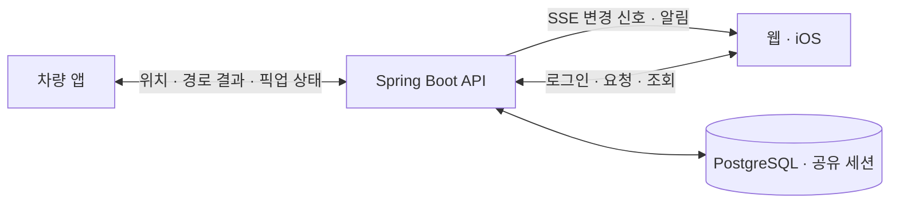

<div align="center">
  
  <h1>마중 백엔드</h1>
  <p>차량과 탑승자가 같은 픽업을 보도록, 상태와 접근 권한을 관리하는 서버.</p>
  <p><a href="https://majung.cloud/api/swagger-ui/index.html">API 명세</a> · <a href="https://majung.cloud/api/v1/health">운영 상태</a> · <a href="https://github.com/majung-team/majung">서비스 소개</a> · <a href="https://github.com/majung-team/majung/wiki">기술 회고</a></p>
</div>

## 위치를 보내는 것보다, 누구에게 언제 보여줄지가 먼저다

차량은 위치와 도착 시간을 보내고, 탑승자는 자신의 픽업을 조회한다. 대기 중인 다음 탑승자에게 앞선 픽업의 위치가 보이거나, 취소한 초대 링크로 계속 접근할 수 있어서는 안 된다.

서버는 차량·운전자·탑승자의 권한과 픽업 상태를 함께 확인한다. 늦게 도착한 위치가 새 위치를 덮어쓰지 않도록 검사하고, 완료·취소·연결 해제 시 조회와 알림도 정리한다. 내비 경로와 실제 도착 시간은 차량의 Pleos SDK가 제공한다.

| 처리 영역 | 하는 일 |
| --- | --- |
| 계정과 차량 | 카카오 로그인·세션, QR 차량 연결·철회, 사람 검색·연결 |
| 초대와 요청 | 30분 초대 링크·게스트 참여, 요청 수락·대기열·순차 진행 |
| 위치와 시간 | 전송 순번·시각·장소 버전 확인, 최신·지연·수신 중단 구분 |
| 소통과 장소 | 준비 상태·짧은 메시지, 장소 제안과 차량 확정 결과 반영 |
| 종료와 알림 | 픽업 종료 후 접근 차단, 미확정 제안·알림 구독 정리 |

SSE는 ‘상태가 바뀌었다’는 신호만 보낸다. 실제 데이터는 인증된 API로 다시 조회하므로, 재접속하거나 로그아웃한 뒤에도 현재 권한을 검사한다. Web Push와 APNs 발송 코드는 설정과 구독이 있는 경우 사용하며, 실제 iPhone 푸시 수신 검증과는 구분한다.

## 먼저 실행해 보기

JDK 25와 저장소의 Gradle Wrapper를 사용한다. 기본 설정은 로컬 H2 파일 DB이며, 카카오 로그인과 푸시는 비활성 상태로 시작한다.

```sh
./gradlew bootRun
```

- 상태 확인: `http://127.0.0.1:8080/api/v1/health`
- API 명세: `http://127.0.0.1:8080/api/swagger-ui.html`
- DB: `./data/majung` 경로의 H2 파일, 운영 DB와 별도

```sh
./gradlew test bootJar --no-daemon
python3 -m unittest discover -s deploy -p 'test_*.py'
```

[기본 설정](src/main/resources/application.properties)을 그대로 쓰면 로컬 API와 DB부터 확인할 수 있다. 회원 로그인·외부 장소 검색·푸시는 각 서비스의 설정이 추가로 필요하다.

| 필요한 기능 | 설정과 안내 |
| --- | --- |
| 카카오 로그인 | `MAJUNG_LOGIN_ENABLED`, `KAKAO_CLIENT_ID`, `KAKAO_CLIENT_SECRET`, `KAKAO_REDIRECT_URI` — [계정 설정](docs/account-connections.md) |
| 장소·지도 | 카카오 REST/JavaScript 키 — [장소 검색 코드](src/main/java/app/majung/server/pickup/service/)와 기본 설정 참고 |
| PostgreSQL | `DB_URL`, `DB_USER`, `DB_PASSWORD` — 운영 설정은 [배포 안내](docs/github-actions.md) 참고 |
| 도착 알림 | VAPID 또는 APNs 키·구독 — [알림 설정](docs/arrival-push.md) |

로컬 HTTP 로그인에는 리다이렉트 URI와 세션 쿠키의 Secure 설정도 맞춰야 한다. 운영 HTTPS 설정을 그대로 로컬 로그인에 사용할 수 있는 것은 아니다. 실제 키나 세션 값은 저장소에 넣지 않는다.

## 구현에서 중요하게 본 세 가지

**이전 응답이 최신 위치를 덮지 않게** — SDK 시각·서버 수신 시각·전송 순번·장소 버전을 비교한다. 서버는 원래 ETA와 정보의 경과 시간을 나눠 보내고, 웹과 중복 차감하지 않는지 실제 응답으로 대조한다. [위치 최신성](docs/vehicle-state.md) · [응답 대조 시험](deploy/test_eta_contract.mjs)

**종료 처리는 관련 정보까지 함께** — 상태만 완료로 바꾸지 않고 위치·미확정 제안·초대 접근·도착 알림을 정리한다. 취소된 요청이 늦게 다시 와도 과거 요청을 되살리지 않는다. [픽업 생명주기](docs/pickup-lifecycle.md)

**배포 중 로그인과 정기 작업 유지** — 두 앱 실행 공간이 PostgreSQL 세션을 공유하고, 현재 요청을 받는 앱만 만료 작업을 수행한다. 배포 전 실제 서비스 계정으로 필요한 파일을 읽을 수 있는지도 검사한다. [운영 장애와 복구](docs/operations-recovery.md)

## 구조와 기술



| 영역 | 구성 |
| --- | --- |
| API·인증 | Java 17 대상 컴파일 · JDK 25 · Spring Boot 4.0.8 · MVC · OAuth2 Client |
| 데이터 | Spring Data JPA · PostgreSQL · Spring Session JDBC · 로컬/시험 H2 |
| 실시간·명세 | SSE · Web Push/VAPID · APNs · springdoc OpenAPI |
| 운영 | Caddy · GitHub Actions · 단일 GCP VM의 Blue-Green 전환 |

<details>
<summary>소스와 실험용 API 구분</summary>

`src/main/java/app/majung/server/pickup/` 아래에 `api`, `service`, `domain`, `repository`, `security`, `push`, `job`, `common`을 나눴다. 시험도 같은 역할별로 `src/test/`에 둔다.

다중 픽업 계획 API(`/api/v1/pickup-plans`)는 별도 구현이다. 현재 [PickupPlanService](src/main/java/app/majung/server/pickup/service/PickupPlanService.java)는 예제 계획을 메모리에 보관한다. 영속화된 운영 픽업·차량 내비의 실제 경로와 연결된 기능으로 설명하지 않는다. 현재 사용자 흐름은 차량당 한 건씩 진행하는 픽업 대기열이다.

</details>

## 배포와 검증 범위

Caddy가 웹 정적 파일과 API를 분기한다. 새 앱을 대기 슬롯에 띄워 상태·DB·세션·빌드 정보를 확인한 뒤 트래픽을 전환한다. 두 슬롯이 같은 VM과 DB를 사용하므로 서버 자체의 이중화는 아니며, 앱 버전 롤백이 DB 구조까지 되돌리지는 않는다.

[Server CI](https://github.com/majung-team/majung-backend/actions)는 JUnit·빌드·배포 스크립트 검사와 웹 ETA 응답 대조를 수행한다. 시험 건수와 당시 결과는 [검증 기록](docs/stability-verification.md)에 남기고, 실제 차량·휴대전화의 장시간 주행이나 원격 푸시 수신은 별도 확인 대상으로 둔다.

[Blue-Green 배포](docs/blue-green.md) · [요청 대기열](docs/ride-requests.md) · [차량 연결](docs/vehicle-account-link.md) · [장소 제안](docs/place-proposal.md) · [기여 가이드](CONTRIBUTING.md)
