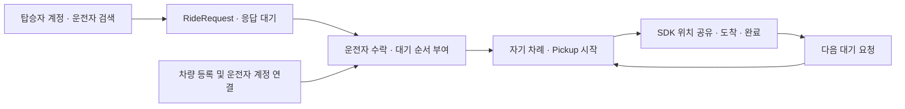

# 탑승자 마중 요청 및 대기열

마중은 탑승자가 먼저 운전자를 검색하고, 원하는 픽업 장소와 함께 마중 요청을 보낼 수 있도록 지원한다.

탑승자는 운전자와 사전에 사람 연결을 맺거나 차량 QR을 받을 필요가 없다.

운전자는 차량에 연결된 본인 계정으로 요청을 확인하고 수락할 수 있다. 수락된 요청은 대기열에 추가되며, 현재 픽업이 종료된 뒤 다음 요청을 순서대로 시작한다.

**요청 수락과 실제 픽업 시작은 서로 다른 동작이다.**

이 문서는 요청 흐름, 상태, 개인정보 공개 범위, API, 동시성 처리 및 검증 결과를 정리한다.

---

## 1. 기본 이용 흐름

### 운전자 최초 준비

운전자는 등록된 차량을 자신의 마중 계정에 연결한다.

1. 차량 앱에서 계정 연결 QR 표시
2. 운전자 휴대전화로 QR 열기
3. 카카오 로그인 및 닉네임 설정
4. 휴대전화에서 계정 연결 요청
5. 차량에서 닉네임과 마중 ID 확인
6. 차량에서 최종 승인

기존에 연결된 차량은 이 절차를 반복하지 않는다.

[차량 최초 연결](vehicle-enrollment.md) · [차량과 운전자 계정 연결](vehicle-account-link.md)

### 탑승자의 요청

1. 마중 모바일 웹 로그인
2. 닉네임 또는 마중 ID로 운전자 검색
3. 현재 위치 또는 원하는 만남 장소 선택
4. 장소 설명과 함께 마중 요청 전송
5. 운전자의 응답 확인
6. 요청 수락 시 대기열 진입
7. 자기 차례에 픽업 상태와 ETA 확인
8. 준비 상태 변경 및 차량 도착 확인

기존 사람 연결 승인을 먼저 받을 필요는 없다.

### 운전자의 처리

1. 차량 앱에서 받은 요청 확인
2. 탑승자와 요청 장소 확인
3. 요청 수락 또는 거절
4. 수락한 요청의 대기 순서 확정
5. 현재 픽업 완료
6. 다음 요청의 장소를 내비게이션 경유지에 추가
7. SDK에서 해당 장소의 경로 확인
8. 픽업 시작
9. 필요한 경우 위치 공유 재개 확인

운전자가 요청을 수락하더라도 기존 사람 연결 목록을 자동으로 변경하지 않는다.

---

## 2. 요청과 픽업의 관계

마중은 여러 요청을 동시에 관리하지만 실제 진행 중인 픽업은 운전자당 한 건만 유지한다.

| 항목 | 정책 |
| --- | --- |
| 사전 사람 연결 | 필수 아님 |
| 운전자 계정 연결 | 필요 |
| 열린 요청 상한 | 운전자당 50건 |
| 동시 수락 | 허용 |
| 대기 순서 | 수락 순서 |
| 활성 픽업 | 운전자당 1건 |
| 순서 임의 변경 | 지원하지 않음 |
| 자동 내비 경로 전환 | 수행하지 않음 |

두 번째, 세 번째 탑승자도 같은 방식으로 요청할 수 있다.

다른 탑승자를 픽업하는 중이라는 이유만으로 새로운 요청의 생성과 수락을 막지 않는다.

다만 앞선 픽업이 종료되기 전에 다음 요청을 실제 픽업으로 시작하지 않는다.

### 요청과 픽업 상태 분리

`RideRequest`는 운전자에게 전달된 사람 간 요청을 관리한다.

`Pickup`은 실제 시작된 차량 픽업을 관리한다.

```text
RideRequest
   │
   ├── PENDING
   │
   ├── QUEUED
   │      │
   │      ▼
   └── ACTIVE ─── Pickup
                     │
                     ▼
                SDK 위치·ETA 공유
                     │
                     ▼
                  픽업 종료
```

차량 계정 연결 정보와 탑승자 요청을 같은 데이터로 관리하지 않는다.

---

## 3. 요청 상태

| 상태 | 의미 | 유효 시간 |
| --- | --- | --- |
| `PENDING` | 운전자 응답 대기 | 30분 |
| `QUEUED` | 운전자가 수락한 픽업 대기 | 2시간 |
| `ACTIVE` | 해당 요청의 픽업 진행 중 | 픽업 생명주기 정책 |
| `COMPLETED` | 픽업 완료 | 종료 상태 |
| `CANCELLED` | 요청 또는 픽업 취소 | 종료 상태 |
| `REJECTED` | 운전자가 요청 거절 | 종료 상태 |
| `EXPIRED` | 유효 시간 만료 | 종료 상태 |

### PENDING

운전자의 수락 또는 거절을 기다리는 상태다.

30분 동안 응답이 없으면 요청이 만료된다.

### QUEUED

운전자가 수락한 요청이다.

수락 순서에 따라 대기열에 추가되며 최대 2시간 동안 대기할 수 있다.

대기 중인 탑승자는 자신의 요청을 취소할 수 있다.

### ACTIVE

운전자가 해당 요청을 실제 픽업으로 시작한 상태다.

이 단계부터 탑승자는 자신에게 허용된 차량 위치와 ETA를 조회할 수 있다.

### 종료 상태

완료·취소·거절·만료된 요청은 종료 상태로 관리한다.

종료된 요청을 통해 기존 차량 위치·ETA를 계속 조회할 수 없다.

---

## 4. 탑승자에게 공개하는 정보

탑승자가 볼 수 있는 정보는 요청 상태에 따라 달라진다.

| 상태 | 탑승자에게 제공하는 정보 |
| --- | --- |
| `PENDING` | 내가 요청한 장소, 운전자 닉네임·마중 ID, 만료 시각 |
| `QUEUED` | 내 앞의 대기 요청 수, 조건을 충족할 때만 현재 픽업의 남은 시간 |
| `ACTIVE` | 내 픽업의 장소·차량 정보·준비 상태 |
| 종료 상태 | 종료 결과, 차량 위치·ETA 접근 차단 |

### 대기 중 개인정보 보호

대기 중인 탑승자에게 다른 탑승자의 다음 정보를 제공하지 않는다.

- 이름
- 마중 ID
- 요청 장소
- 위치 좌표
- 개별 픽업 접근 토큰

대기열의 순서와 현재 진행 중인 픽업의 일부 시간 정보만 허용된 범위에서 제공한다.

### 현재 픽업의 남은 시간

대기자는 현재 진행 중인 픽업의 ETA를 제한적으로 볼 수 있다.

하지만 이 시간은 **대기자 본인의 차량 도착 예정 시간이 아니다.**

현재 진행 중인 픽업의 목적지까지 남은 시간을 뜻한다.

다음 정보는 포함하지 않는다.

- 현재 탑승자의 실제 승하차 소요 시간
- 다음 요청 장소까지 이동 시간
- 추가 경로 변경에 따른 소요 시간

현재 경로를 확인할 수 없거나 SDK 정보가 오래됐다면 시간을 표시하지 않는다.

---

## 5. 탑승자 API

탑승자 API는 로그인된 웹 세션을 사용한다.

상태 변경 요청에는 CSRF 검증이 적용된다.

| Method | API | 기능 |
| --- | --- | --- |
| `POST` | `/api/v1/ride-requests` | 마중 요청 생성 |
| `GET` | `/api/v1/ride-requests` | 내가 보낸 최근 요청 조회 |
| `POST` | `/api/v1/ride-requests/{id}/cancel` | 대기 중 요청 취소 |
| `GET` | `/api/v1/ride-requests/{id}/tracking` | 내 픽업 정보 조회 |
| `PUT` | `/api/v1/ride-requests/{id}/readiness` | 내 준비 상태 변경 |

### 요청 생성

```http
POST /api/v1/ride-requests
```

주요 요청 필드:

- `driverId`
- `requestId`
- `place`

`requestId`는 UUID 형식이며 동일 요청의 재전송을 구분하는 데 사용한다.

같은 요청 ID와 동일한 내용으로 다시 전송하면 기존 요청을 반환한다.

서로 다른 요청을 같은 ID로 처리하지 않는다.

### 요청 목록

```http
GET /api/v1/ride-requests
```

로그인된 계정이 보낸 최근 요청 최대 50건을 조회한다.

다른 계정의 요청 목록은 제공하지 않는다.

### 요청 취소

```http
POST /api/v1/ride-requests/{id}/cancel
```

탑승자는 `PENDING` 또는 `QUEUED` 상태의 자신의 요청을 취소할 수 있다.

이미 시작된 픽업의 취소는 차량의 픽업 종료 흐름에서 처리한다.

### 픽업 추적

```http
GET /api/v1/ride-requests/{id}/tracking
```

자신의 픽업이 실제로 시작된 후에만 장소와 차량 정보를 조회할 수 있다.

다른 탑승자의 요청이나 자기 차례가 오지 않은 요청을 이용해 차량 정보를 조회할 수 없다.

### 준비 상태 변경

```http
PUT /api/v1/ride-requests/{id}/readiness
```

해당 픽업의 탑승자가 준비 상태와 증가하는 `sequence`를 전송한다.

순번을 이용해 중복·역순 상태 변경을 구분한다.

---

## 6. 차량 API

차량 API는 등록된 차량의 Bearer 권한을 사용한다.

운전자 휴대전화의 로그인 세션을 차량 장치 권한으로 대신 사용하지 않는다.

| Method | API | 기능 |
| --- | --- | --- |
| `GET` | `/api/v1/vehicles/ride-requests` | 받은 요청·대기열·진행 중 요청 조회 |
| `POST` | `/api/v1/vehicles/ride-requests/{id}/accept` | 요청 수락 |
| `POST` | `/api/v1/vehicles/ride-requests/{id}/reject` | 요청 거절 |
| `POST` | `/api/v1/vehicles/ride-requests/{id}/start` | 해당 요청의 실제 픽업 시작 |

### 요청 수락

```http
POST /api/v1/vehicles/ride-requests/{id}/accept
```

운전자가 요청을 수락하면 대기열에 추가하고 순서를 부여한다.

수락만으로 차량의 현재 경로나 활성 픽업을 자동 변경하지 않는다.

### 요청 거절

```http
POST /api/v1/vehicles/ride-requests/{id}/reject
```

아직 응답하지 않은 요청을 거절한다.

### 픽업 시작

```http
POST /api/v1/vehicles/ride-requests/{id}/start
```

먼저 수락한 요청부터 실제 픽업으로 시작한다.

기존 활성 픽업이 있는 경우 HTTP 409로 시작을 차단한다.

내비게이션 경로와 요청 장소를 확인하는 과정은 차량 앱에서 수행한다.

---

## 7. 픽업 시작과 재시도

### 기존 Pickup 연결

`RideRequest`를 실제로 시작할 때는 기존 `Pickup` 구조를 사용한다.

요청 기능만을 위해 별도의 위치 공유 시스템을 만들지 않는다.

픽업이 시작되면 기존 기능을 이용한다.

- 내비게이션 경로 확인
- 차량 위치·ETA 공유
- 탑승자 준비 상태
- 차량 도착
- 탑승 완료
- 종료 및 권한 정리

### 시작 응답 유실

픽업 시작 요청은 서버에서 처리됐지만 차량이 응답을 받지 못할 수 있다.

이때 새로운 픽업을 다시 생성하지 않는다.

같은 요청의 시작 상태를 재확인하면 기존 `pickupId`를 반환한다.

필요한 차량 접근 토큰은 교체하여 복구한다.

### 토큰 처리

요청 기반 픽업을 시작할 때 공개 초대 링크나 별도 탑승자 토큰을 새로 발급해 휴대전화에 저장하지 않는다.

탑승자는 자신의 로그인 세션과 요청 접근 권한을 통해 픽업 정보를 조회한다.

### 자동 재시도 제한

통신 실패가 발생했다고 해서 상태 변경 요청을 무조건 자동 재전송하지 않는다.

먼저 현재 요청과 픽업 상태를 확인한다.

---

## 8. 내비게이션 연동

수락된 요청은 실제 픽업 시작 전에 차량에서 경로를 확인한다.

### 시작 절차

1. 현재 픽업 종료 확인
2. 다음 대기 요청 선택
3. 요청 장소 확인
4. 내비게이션 경유지 추가
5. SDK에서 해당 장소의 경로 확인
6. 서버에 픽업 시작 요청
7. 위치 공유 재개 확인

경로가 확인되지 않으면 요청을 실제 픽업으로 시작하지 않는다.

### 기존 경로 유지

다른 탑승자의 요청을 수락했다는 이유만으로 현재 내비게이션 경로를 변경하지 않는다.

대기열 순서를 임의로 변경하거나 다음 장소를 자동으로 목적지에 설정하지 않는다.

### 위치 공유 재개

차량에서 픽업을 시작한 뒤 필요한 경우 운전자가 위치 공유 계속하기를 통해 재개 여부를 확인한다.

기존 픽업 공유 서비스의 권한 및 실행 조건을 따른다.

---

## 9. 접근 권한 및 오류 처리

### 인증 방식

| API 구분 | 인증 |
| --- | --- |
| 탑승자 요청·조회 | 웹 로그인 세션 |
| 탑승자 상태 변경 | 웹 세션 + CSRF |
| 차량 받은 요청·수락·시작 | 차량 Bearer 권한 |

차량 장치 토큰을 탑승자 휴대전화에 전달하지 않는다.

### 주요 HTTP 오류

| 상태 | 의미 |
| --- | --- |
| `401` | 로그인 필요 |
| `403` | CSRF 검증 실패 또는 자기 차례 전 추적 차단 |
| `404` | 다른 사람·다른 운전자의 요청 접근 |
| `409` | 픽업 진행 순서 충돌, 중복 열린 요청, 차량 계정 미연결 등 |

일반적인 실패 응답만으로 요청이 실제로 생성되지 않았다고 판단하지 않는다.

상태를 확인할 수 있는 API를 사용해 현재 결과를 먼저 확인한다.

---

## 10. 데이터 구조 및 동시성 처리

### RideRequest와 Pickup

`RideRequest`는 탑승자와 운전자 사이의 요청을 저장한다.

실제 픽업을 시작할 때 기존 `Pickup`과 연결한다.

차량 계정 연결, 사람 연결, 탑승자 요청 및 실제 픽업을 하나의 테이블이나 상태로 합치지 않는다.

### 잠금 순서

차량 관련 작업은 다음 순서로 잠금을 획득한다.

```text
차량 행
   ↓
운전자 행
   ↓
픽업 행
```

요청 생성·취소는 운전자 행을 기준으로 순서를 맞춘다.

운전자 행을 먼저 잠근 뒤 차량 행을 나중에 잠그는 흐름은 사용하지 않는다.

이는 서로 다른 API가 반대 순서로 잠금을 획득하며 충돌하는 상황을 줄이기 위한 설계다.

### 동시 수락

여러 요청을 동시에 수락해도 서로 다른 대기 순서를 부여한다.

앞선 픽업이 끝나기 전 다음 요청의 시작은 차단한다.

### 요청 수 상한

한 운전자에게 열려 있는 요청은 최대 50건이다.

무제한 요청으로 대기열과 서버 자원을 점유하지 못하도록 제한한다.

---

## 11. 카카오 연결 해제 시 처리

카카오 연결 해제로 계정이 정리되는 경우 해당 계정의 요청도 함께 정리한다.

### 처리 기준

- 연결 해제된 계정의 요청 삭제
- 해당 요청에서 시작된 픽업의 공유 종료
- 다른 계정의 요청 보존

계정과 연결된 픽업 정보는 권한 해제 이후에도 계속 공개하지 않는다.

다른 사용자 계정이나 요청에 불필요하게 영향을 주지 않도록 한다.

[카카오 로그인 및 계정 연결](account-connections.md)

---

## 12. 요청 보관 및 정리

종료된 요청은 기본적으로 종료 시각인 `endedAt`을 기준으로 7일 후 정리한다.

### 요청 상태별 기준

- 종료된 요청: 종료 시각 기준
- 만료된 요청: 만료 시각 기준
- 픽업과 연결된 요청: 해당 픽업의 종료 상태와 시각 확인

요청 생성 시각만으로 진행 중인 픽업의 기록을 먼저 삭제하지 않는다.

픽업이 아직 활성 상태라면 연결된 요청도 필요한 기간 동안 유지한다.

자세한 기준은 [픽업 자동 종료 및 보관 정책](pickup-lifecycle.md)을 따른다.

---

## 13. 데이터베이스 적용

기존 운영 DB에는 차량 계정 연결과 픽업 요청 관련 SQL을 순서대로 적용한다.

### 업그레이드 SQL

```text
upgrade-vehicle-accounts.sql
upgrade-ride-requests.sql
```

### 적용 순서

1. 운영 PostgreSQL 백업
2. `upgrade-vehicle-accounts.sql` 적용
3. `upgrade-ride-requests.sql` 적용
4. 신규 테이블 및 컬럼 확인
5. 애플리케이션 DB 사용자 권한 확인
6. 서버 배포
7. 차량 앱 및 모바일 웹 연동 확인

실행 계정에는 신규 관련 테이블 3개에 필요한 권한을 부여한다.

- `SELECT`
- `INSERT`
- `UPDATE`
- `DELETE`

신규 데이터베이스는 `initial-schema.sql`을 사용한다.

일반 애플리케이션 배포에서 해당 업그레이드 SQL을 자동 실행하지 않는다.

### 배포 주의사항

DB 스키마 변경은 백업과 버전 호환성을 확인한 뒤 적용한다.

이전 서버로 코드를 복구하더라도 이미 적용한 DB 변경이 자동으로 되돌아가지는 않는다.

---

## 14. 웹 위치 선택 및 개인정보

탑승자는 모바일 웹에서 현재 위치 또는 원하는 만남 장소를 선택한다.

### 장소 선택 방법

- 현재 위치
- 장소명 검색
- 주소 검색
- 지도 핀 선택

선택한 장소는 같은 `place` 형식으로 서버에 전달한다.

별도 장소 공급자의 장소 ID는 요구하지 않는다.

[웹 장소 선택 구현](https://github.com/majung-team/majung-web/blob/main/docs/pickup-place-selection.md)

### 브라우저 위치 권한

현재 위치 선택에는 HTTPS와 브라우저의 위치 접근 권한이 필요하다.

Caddy는 다음 Permissions-Policy를 사용한다.

```http
Permissions-Policy: geolocation=(self)
```

좌표는 API 요청 본문으로 전달하고 URL이나 일반 로그에 기록하지 않는다.

---

## 15. 테스트 및 검증

**최초 검증 기준: 2026년 10월 25일**

로컬 서버 자동화 테스트와 가상 계정 브라우저 시험으로 주요 요청 흐름을 확인했다.

### 요청 생성 및 대기열

- 신규 탑승자 3명의 마중 요청
- 동시 수락 시 서로 다른 대기 순서
- 기존 초대 픽업 중 새 요청 수락
- 기존 픽업 종료 전 다음 요청 시작 차단
- 동일 요청 재전송
- 대기 중 요청 취소
- 응답 대기 30분 만료

### 접근 권한

- 다른 사용자의 요청 조회 차단
- 다른 차량의 요청 수락 차단
- 자기 차례 전 차량 정보 접근 차단
- 운전자 계정 연결 권한 확인

### 계정 및 픽업 종료

- 계정 연결 해제 시 관련 픽업 공유 종료
- 요청과 실제 픽업 상태 연동
- 종료된 요청의 위치 공유 차단

### 차량 계정 연결

로컬 브라우저와 차량 권한 API에서 다음 과정을 확인했다.

- QR을 통한 로그인 복귀
- 휴대전화 연결 요청
- 차량에서 계정 확인
- 차량 승인 후 연결 완료

이 결과는 로컬 가상 계정 및 시험 환경을 기준으로 한다.

---

## 16. 현재 기능 범위 및 별도 검증

### 구현된 흐름

- 운전자 검색 후 마중 요청
- 현재 위치와 장소를 이용한 요청
- 차량의 요청 수락·거절
- 수락 순서에 따른 대기열
- 한 건씩 실제 픽업 시작
- 기존 SDK 기반 위치·ETA 공유
- 탑승자별 정보 접근 제한
- 웹의 장소명·주소 검색 및 지도 핀 선택

### 별도 작업 및 검증 항목

- 대기 순서 임의 변경
- 차량 앱이 닫힌 상태의 요청 도착 푸시
- 실제 휴대전화 GPS 정확도 확인
- 실제 휴대전화 간 전체 연동
- 실차 내비게이션 경로 및 주행 검증

**화면 밖 요청 도착 알림은 구현됐다고 안내하지 않는다.**

차량이 주행 중인 경우에는 기존 Pleos 주행 제한 정책을 따른다.

요청 수락과 픽업 시작을 위해 주행 중 상세 조작을 허용하지 않는다.

---

## 17. 전체 연결 구조



핵심 흐름은 요청 생성과 실제 픽업 시작의 분리다.

수락된 요청은 대기열에서 관리하고, 내비게이션 경로를 확인한 후 기존 Pickup 기능을 이용해 한 건씩 실행한다.

---

## 18. 관련 문서

- [백엔드 README](../README.md)
- [차량 QR 최초 연결](vehicle-enrollment.md)
- [차량과 운전자 계정 연결](vehicle-account-link.md)
- [카카오 로그인 및 계정 연결](account-connections.md)
- [차량 위치 최신성](vehicle-state.md)
- [픽업 자동 종료 및 보관](pickup-lifecycle.md)
- [장소 변경 제안](place-proposal.md)
- [차량 앱 요청·픽업 흐름](https://github.com/majung-team/majung-vehicle-app/blob/main/docs/request-pickup-flow.md)
- [웹 장소 선택](https://github.com/majung-team/majung-web/blob/main/docs/pickup-place-selection.md)
- [개발 현황 및 PR 근거](https://github.com/majung-team/majung/blob/main/docs/development-status.md)

---

## 문서 관리 기준

이 문서는 탑승자가 먼저 보내는 마중 요청과 운전자의 대기열 처리 구조를 설명한다.

다음 항목은 서로 구분하여 관리한다.

- 사람 연결과 픽업 요청
- 운전자 계정 연결과 차량 장치 권한
- 요청 수락과 실제 픽업 시작
- 대기 중 시간 정보와 본인 픽업 ETA
- 요청 상태와 Pickup 상태
- 구현된 기능과 실제 기기 검증 결과

요청 상태, API 또는 권한 정책을 변경할 경우 서버·차량 앱·모바일 웹의 동작을 함께 확인한다.

테스트 결과는 사용한 환경과 커밋을 기준으로 기록한다.
