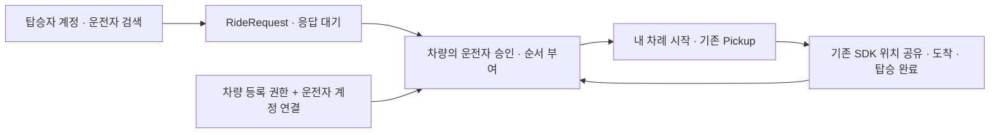

# 탑승자가 먼저 보내는 마중 요청

차량과 연결한 적 없는 탑승자도 운전자를 검색해 장소와 함께 요청한다. 차량에 연결하는 계정은 운전자 계정이다. 탑승자는 차량 QR을 받을 필요가 없다.

## 사용하는 순서

1. 운전자가 등록된 차량에서 계정 연결 QR을 연다.
2. 운전자 휴대전화에서 로그인하고 연결 요청을 보낸다. 차량에서 닉네임·마중 ID를 확인하고 승인한다. 이 절차는 처음 한 번만 필요하다.
3. 탑승자는 로그인 후 운전자를 검색한다. 현재 위치와 만날 장소 설명을 선택하고 마중 요청을 보낸다. 기존 사람 연결 승인을 먼저 받지 않아도 된다.
4. 운전자는 차량의 받은 요청에서 장소와 사람을 확인하고 수락한다. 수락 순서대로 대기에 추가된다. 이 승인은 이번 픽업에 대한 동의이며 기존 ‘사람 연결’ 목록을 자동으로 바꾸지는 않는다.
5. 현재 픽업을 마치면 다음 요청 장소를 내비 경유지에 추가한다. SDK에서 같은 장소의 경로가 확인된 뒤 픽업을 시작한다. 위치 공유는 계속하기를 눌러 다시 확인한다.
6. 탑승자는 자기 차례가 오면 도착 예상 시간과 준비 상태를 확인한다.

두 번째·세 번째 탑승자도 같은 방식으로 요청한다. 다른 사람을 픽업 중이라는 이유로 요청·수락을 막지 않는다. 한 번에 실제 진행하는 픽업은 한 건이다. 무제한 요청으로 서비스를 막지 않도록 운전자별 열린 요청은 50건으로 제한한다.

## 상태와 공개 범위

| 상태 | 의미 | 탑승자가 보는 정보 |
| --- | --- | --- |
| PENDING | 운전자 응답 대기, 30분 만료 | 내가 요청한 장소, 운전자 닉네임·ID, 만료 시각 |
| QUEUED | 운전자가 수락, 픽업 대기 | 내 앞의 요청 수. 현재 진행 중인 픽업의 남은 시간이 새 정보일 때만 별도로 표시 |
| ACTIVE | 내 픽업 진행 중 | 내 장소와 내 픽업의 차량 정보, 준비 상태 |
| COMPLETED / CANCELLED / REJECTED / EXPIRED | 종료 | 종료 상태. 위치 공유 차단 |

대기 중인 사람에게 다른 탑승자의 이름·마중 ID·장소·좌표를 보내지 않는다. ‘현재 진행 중인 픽업까지 남은 시간’은 대기자의 도착 예정 시간이 아니다. 승하차 시간이나 다음 경로는 포함하지 않는다. 경로가 확인되지 않거나 정보가 오래되면 시간을 감춘다.

수락한 요청은 2시간 동안 대기할 수 있다. 30분 규칙은 응답 전 요청에 적용한다. 대기 중 탑승자가 직접 취소할 수 있다. 진행 중인 픽업 취소는 차량에서 처리한다. 순서를 임의로 바꾸거나 자동으로 내비 경로를 전환하지 않는다.

## API

계정 API는 HttpOnly 세션과 CSRF를 사용한다. 차량 API는 등록된 차량의 Bearer 권한을 사용한다. 휴대전화에 차량 권한을 전달하지 않는다.

| 호출 | 용도 |
| --- | --- |
| POST /api/v1/ride-requests | driverId, requestId(UUID), place로 요청. 같은 요청 번호·내용의 재전송은 같은 요청 반환 |
| GET /api/v1/ride-requests | 내가 보낸 최근 50건 |
| POST /api/v1/ride-requests/{id}/cancel | 내 응답 대기·픽업 대기 취소 |
| GET /api/v1/ride-requests/{id}/tracking | 자기 픽업이 시작된 뒤에만 장소·차량 정보 조회 |
| PUT /api/v1/ride-requests/{id}/readiness | 자기 픽업 준비 상태와 증가하는 sequence 전송 |
| GET /api/v1/vehicles/ride-requests | 차량과 연결된 운전자의 받은 요청·대기·진행 목록 |
| POST /api/v1/vehicles/ride-requests/{id}/accept | 이번 요청 수락·대기 순서 부여 |
| POST /api/v1/vehicles/ride-requests/{id}/reject | 응답 대기 요청 거절 |
| POST /api/v1/vehicles/ride-requests/{id}/start | 먼저 수락한 요청부터 기존 픽업으로 연결. 기존 차량 픽업이 있으면 409 |

start 재확인은 같은 pickupId를 반환하고 차량의 접근 토큰을 교체한다. 응답 유실 후 다른 픽업을 새로 만들지 않고 같은 요청에서 복구한다. 공개 초대나 탑승자 토큰을 새로 발급해 휴대전화에 저장하지 않는다.

주요 오류: 로그인 필요 401, CSRF·자기 차례 전 추적 차단 403, 다른 사람·다른 운전자의 요청 404, 진행 순서·중복된 열린 요청·차량 미연결 409. 통신 실패 때 쓰기 요청을 자동으로 반복하지 않는다.

## 저장·동시 처리

- RideRequest는 사람 간 요청을 저장하고, 시작 시 기존 Pickup과 연결한다. 차량 연결과 탑승자 목록을 같은 테이블에 넣지 않는다.
- 차량 작업은 차량 행 → 운전자 행 → 픽업 행 순서로 처리한다. 요청 생성·취소는 운전자 행으로 순서를 맞추며 차량 행을 나중에 잠그지 않는다.
- 동시 수락도 서로 다른 순서를 받는다. 앞선 픽업 종료 전 다음 요청 시작은 차단한다.
- 카카오 연결 해제 시 해당 계정의 요청을 지우고 요청에서 시작한 픽업의 공유를 종료한다. 다른 계정의 요청은 유지한다.
- 종료된 요청은 endedAt 기준 7일 뒤 정리한다. 픽업과 연결된 요청은 픽업 종료 시각도 함께 확인해 진행 중 데이터가 먼저 삭제되지 않게 한다. 자세한 기준은 [자동 종료·보관 정책](pickup-lifecycle.md)을 따른다.

## 배포 전

기존 DB에는 `upgrade-vehicle-accounts.sql`, `upgrade-ride-requests.sql` 순서로 적용한다. DB 백업을 먼저 만들고 실행 계정에 세 테이블의 SELECT·INSERT·UPDATE·DELETE 권한을 부여한다. 신규 DB는 initial-schema.sql을 사용한다. 앱 배포가 SQL을 자동 실행하지는 않는다.

휴대전화 위치 선택에는 HTTPS와 브라우저의 위치 권한이 필요하다. Caddy의 Permissions-Policy는 `geolocation=(self)`로 둔다. 좌표는 요청 본문에만 보내고 주소·로그에 남기지 않는다.

## 현재 범위

현재 위치에서 요청하는 방식부터 연결했다. 웹에서 장소명·주소 검색, 지도 핀 또는 현재 위치를 선택해 같은 place 형식으로 요청한다. 공급자 장소 ID는 받지 않는다. [웹 장소 선택](https://github.com/majung-team/majung-web/blob/main/docs/pickup-place-selection.md)을 따른다. 대기 순서 변경, 앱이 닫혀 있을 때 요청 푸시, 실제 휴대전화 GPS·실차 시험은 별도 작업이다. 운전 중에는 기존 차량 조작 제한을 따른다. 화면 밖 요청 도착 알림이 구현됐다고 안내하지 않는다.

## 연결 구조

2026-10-25 로컬 자동 시험과 가상 계정 브라우저 시험 기준이다. 세 명의 신규 탑승자 요청, 동시 수락의 순서 분리, 기존 초대 픽업 중 요청 수락과 다음 시작 차단, 요청 재전송, 취소·30분 만료, 타인 조회·다른 차량 수락 차단, 계정 연결 해제 시 공유 종료를 확인했다. 차량 QR의 로그인 복귀와 차량 승인 후 연결 완료도 로컬 브라우저·차량 권한 API로 확인했다.
